# AlphaNode · Global Industry Data Atlas

[简体中文](README.md) · **English**

## 1. Overview

AlphaNode is a dashboard for studying market fundamentals. Compare industries side by side, then look at the companies behind the averages to see how they earn profits and turn invested capital into returns.

The initial financial dataset covers **2016–2025**, with **1,208 companies**, **42 economies** and **11,354 company-years**. The securities directory has **121,601 current and historical listing records**, with **1,165 companies** matched to local financial data.

## 2. What you can do

### Explore the data tables

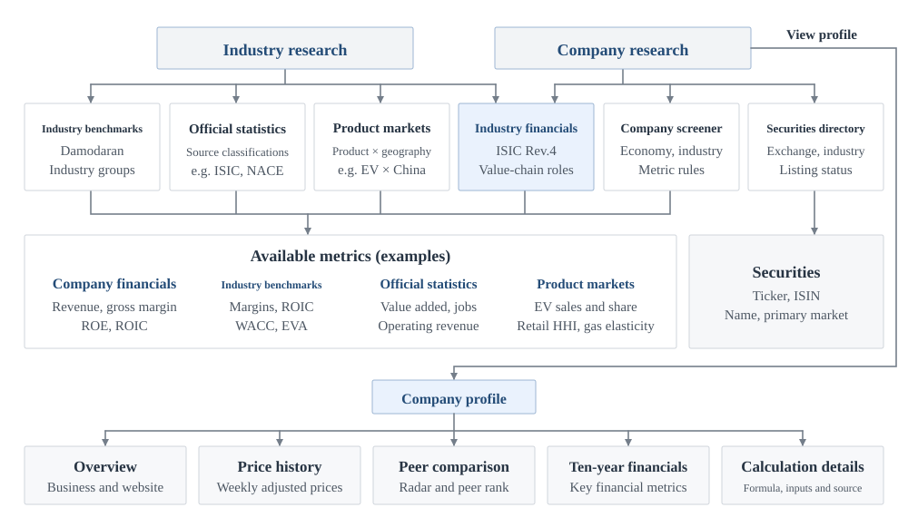

- **Industry research.** Compare company financials by ISIC Rev.4 or by role in the value chain. Browse Damodaran's industry benchmarks, official statistics and product markets.
- **Company research.** Combine metric rules in the screener, use advanced expressions and save presets. The securities directory lists tickers, exchanges and listing information. Open a company profile for its overview, price history, peer comparison, ten-year financials and calculation details.
- **Comparison controls.** Select a geography, industry level, year and time basis. Choose columns, sort by a metric and switch between weighted aggregates and equal-weight company averages.

### Compare trends and build a workbench

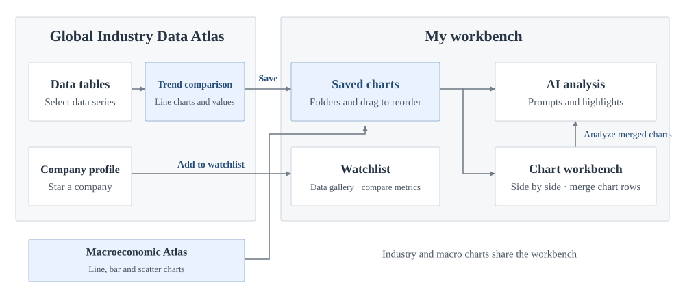

Add a series with **+**, set a metric and time basis, or compare against a common base year. Drag panel dividers to resize the view. Click a legend item to locate the series in the table or open the company profile. Save charts, organize them into folders, and compare or merge chart rows in the Workbench. Star a company to add it to the watchlist.

### Adjust the display

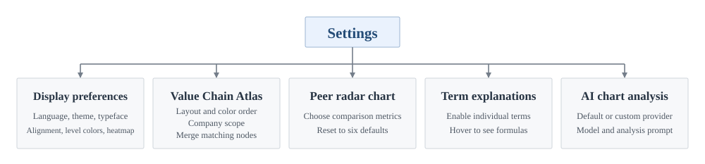

Set the interface language, theme and table alignment. Choose peer radar metrics, enable explanations on hover, and configure the AI provider and analysis prompt.

## 3. Worked example

### From industry returns to one company's cash flow

Xiaoba wants to understand the rise in weighted returns in information and communication. He starts by comparing industry returns, then checks which companies move the averages and how two software businesses turn gross profit into operating profit and cash.


The example uses AlphaNode's 2016–2025 financial data. For the English interface shown here, choose **Settings → Language → English**.

#### ① Does the industry lead when every company has the same weight?

In **Industry financials**, select **ISIC Rev.4**, **Worldwide**, **Annual value** and **Sum / weighted**. Add manufacturing and information and communication to a trend chart and choose **ROIC**. Information and communication trails manufacturing in 2022 (**14.75%** versus **17.22%**) and overtakes it in 2024 (**17.04%** versus **14.18%**).

Expand **Information and communication → Publishing activities → Software publishing** and add the subindustry. Make a second chart and add the same series using **Equal-weight mean**.

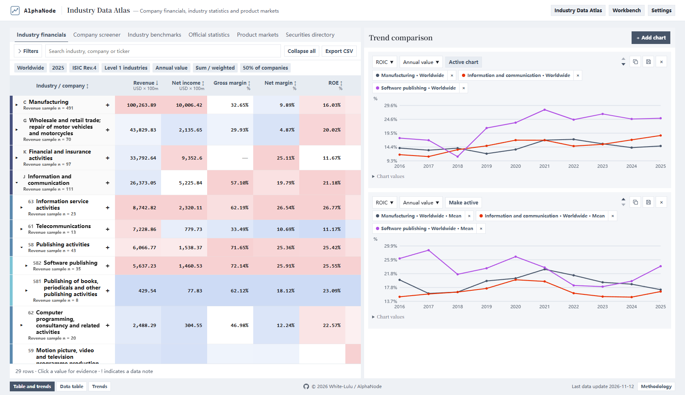

| Worldwide sample · 2025 ROIC | Weighted | Equal weight | Companies with data |
| --- | ---: | ---: | ---: |
| Information and communication | 18.63% | 16.58% | 63 |
| Manufacturing | 14.78% | 17.13% | 313 |
| Software publishing | 24.95% | 24.00% | 21 |

Information and communication leads by **3.85 percentage points** with capital weights and trails by **0.55 points** with equal weights. In the distribution previews below, bar height is company ROIC. The top panel gives companies equal width and uses a teal mean line. The bottom panel gives each company a width proportional to its invested capital and uses a purple weighted mean line. Interactive distributions are planned for a future version.

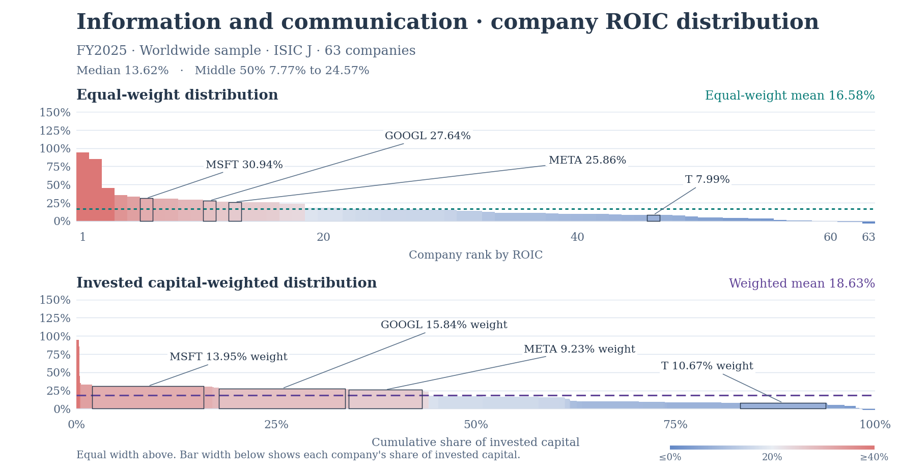

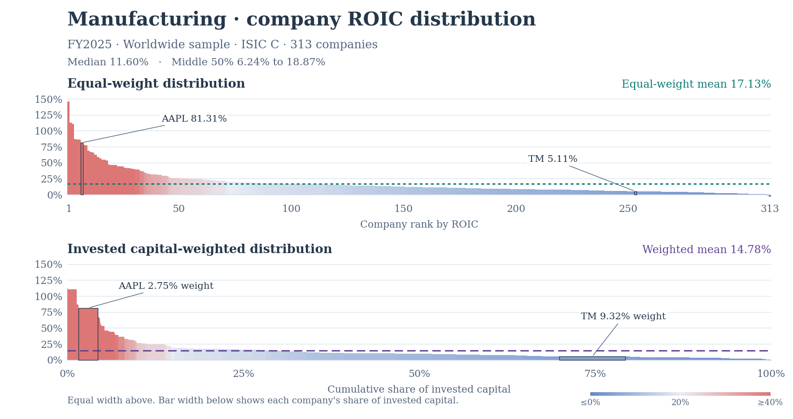

The medians are **13.62%** for information and communication and **11.60%** for manufacturing. A group of high-return manufacturers lifts the manufacturing mean above its median. To inspect the contributors, click the industry's ROIC value and expand **Company inputs and filings**. Open a company and use the calculation details to find its average invested capital. Convert the amounts to USD before recomputing the weights.

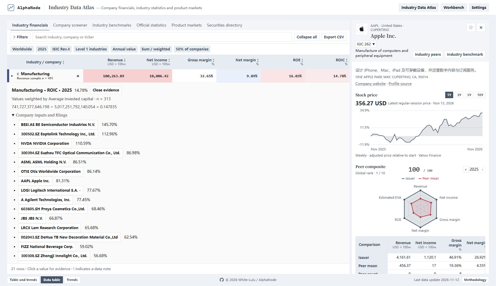

| Industry | Company | ROIC | Share of eligible industry capital |
| --- | --- | ---: | ---: |
| Information and communication | Microsoft (MSFT) | 30.94% | 13.95% |
| Information and communication | Alphabet (GOOGL) | 27.64% | 15.84% |
| Information and communication | Meta (META) | 25.86% | 9.23% |
| Information and communication | AT&T (T) | 7.99% | 10.67% |
| Manufacturing | Toyota (TM) | 5.11% | 9.32% |
| Manufacturing | Apple (AAPL) | 81.31% | 2.75% |

Microsoft, Alphabet and Meta account for **39.02%** of eligible invested capital and all earn above the industry average. Excluding the three leaves weighted ROIC at **10.46%** in 2024 and **12.38%** in 2025, below manufacturing in both years. Excluding Toyota alone raises manufacturing's 2025 weighted ROIC from **14.78%** to **15.78%**.

#### ② Why does one company post an operating loss despite an 80% gross margin?

In **Company screener**, choose 2025 and select **582 Software publishing**. Add a rule for a gross margin of at least 80% and sort by operating margin, highest first. Show margins, gross profit, operating profit and R&D intensity in **Columns**. Star Adobe and Atlassian for side-by-side comparison.

| FY2025 | Gross margin | Operating margin | Net margin | FCF margin |
| --- | ---: | ---: | ---: | ---: |
| Adobe (ADBE) | 89.27% | 36.63% | 30.00% | 41.45% |
| Atlassian (TEAM) | 82.84% | −2.50% | −4.92% | 27.14% |

Gross margins differ by **6.43 points**, while operating margins differ by **39.13 points**. Atlassian's roughly **$4.32 billion** in gross profit and **$130 million** operating loss imply **$4.45 billion** in operating expenses. Click **51.18%** in the R&D intensity column to trace **$2.67 billion** in R&D, about **60%** of those expenses.

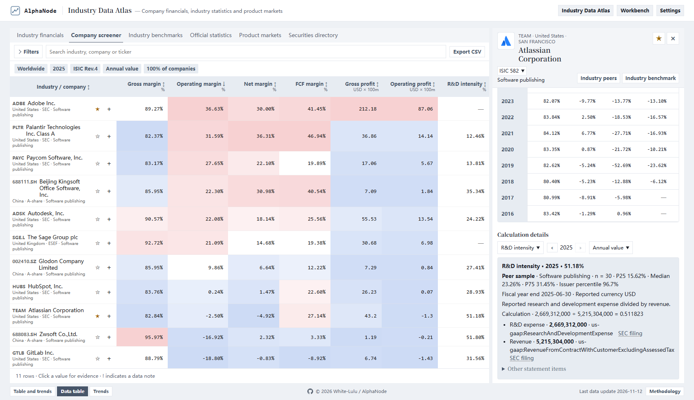

Adobe spent about **$4.29 billion** on R&D, or **18.07%** of revenue. Atlassian spent fewer dollars and devoted **51.18%** of revenue to R&D. That gap accounts for the largest part of the difference in operating margins. To assess the payoff, follow paid adoption, margins and cash flow as revenue grows. [Adobe FY2025 10-K](https://www.sec.gov/Archives/edgar/data/796343/000079634326000003/adbe-20251128.htm) · [Atlassian FY2025 10-K](https://www.sec.gov/Archives/edgar/data/1650372/000165037225000036/team-20250630.htm)

#### ③ How can a loss-making company generate positive free cash flow?

Switch **Calculation details** to **FCF margin** and keep the year at 2025. Subtract **$44,850,000** in capital expenditures from **$1,460,393,000** in operating cash flow, then divide by **$5,215,304,000** in revenue. The result is **27.14%**.

Follow **SEC filing → Document Format Files → 10-K → Item 8 → Consolidated Statements of Cash Flows** and read the 2025 column. The link in the example points to the FY2026 filing with 2025 comparatives. The excerpt below is from the original FY2025 report, in thousands of dollars. [FY2026 filing detail](https://www.sec.gov/Archives/edgar/data/1650372/000165037226000036/0001650372-26-000036-index.htm) · [FY2025 cash flow statement](https://www.sec.gov/Archives/edgar/data/1650372/000165037225000060/team2025annualreport.pdf#page=73)

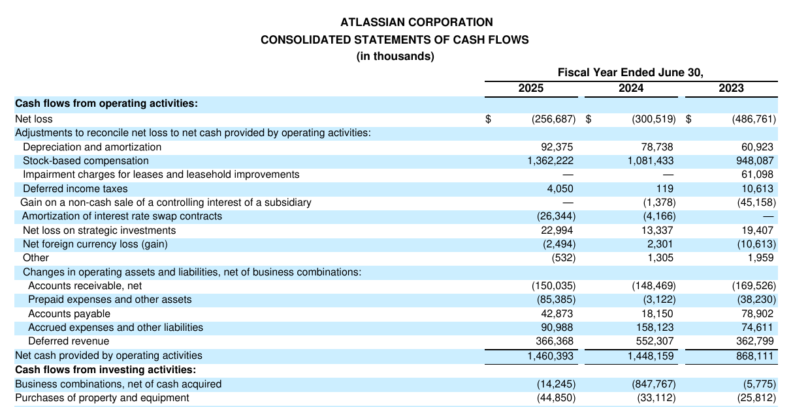

Atlassian added back roughly **$1.36 billion** in stock-based compensation and recorded **$366 million** from the change in deferred revenue. Stock-based compensation reduces reported earnings without an equivalent cash payment in the period. Cash collections, capital expenditures and shareholder dilution are worth tracking in later filings.

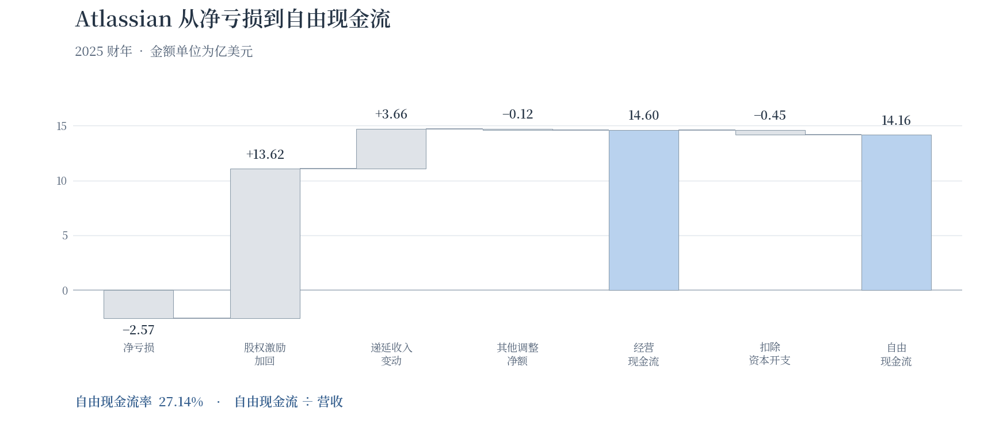

#### ④ What would you check next?

Save an operating margin chart and an FCF margin chart. Open **Workbench**, add both to the **Chart workbench**, place them in the same row, and use **Select chart rows → Merge and save**.

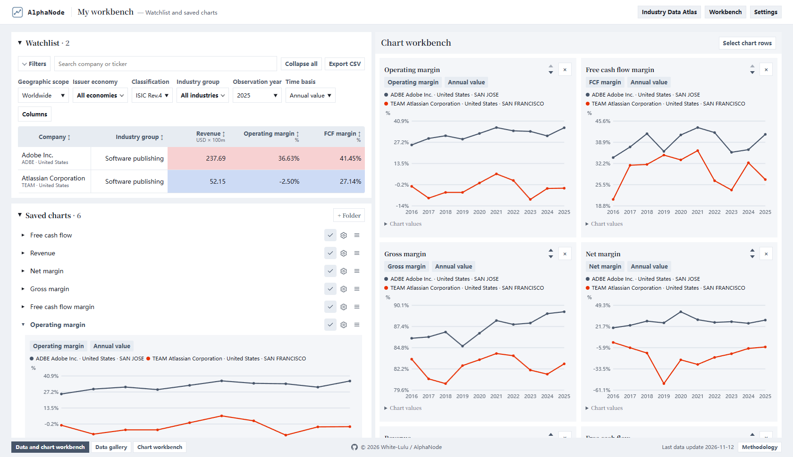

Atlassian's operating margin improved from **−9.77%** in 2023 to **−2.50%** in 2025. From 2024 to 2025 its free cash flow stayed near **$1.42 billion**, while revenue rose about **19.7%**. FCF margin fell from **32.47%** to **27.14%**. Over the same year, Adobe's operating margin rose from **31.35%** to **36.63%** and its FCF margin from **36.61%** to **41.45%**.

Adobe's **$1 billion Figma termination fee** lowered both operating profit and operating cash flow in FY2024. Adding it back to operating profit alone gives a FY2024 operating margin of about **36.00%**, close to **36.63%** in FY2025. [Adobe FY2025 10-K](https://www.sec.gov/Archives/edgar/data/796343/000079634326000003/adbe-20251128.htm)

Try asking the chart analysis:

> Compare operating margin and free cash flow margin for Adobe and Atlassian from 2023 to 2025. Identify when the two metrics moved in opposite directions, quote the chart values and suggest two questions to check against the filings.

For Atlassian, track cloud revenue and the count of customers with more than $10,000 in Cloud ARR, then follow R&D intensity, margins, free cash flow, stock-based compensation and deferred revenue. R&D may take years to affect revenue, and consolidated statements rarely show costs and returns by project. [Key business metrics](https://www.sec.gov/Archives/edgar/data/1650372/000165037225000060/team2025annualreport.pdf#page=52) · [Income statement](https://www.sec.gov/Archives/edgar/data/1650372/000165037225000060/team2025annualreport.pdf#page=70) · [Cash flow statement](https://www.sec.gov/Archives/edgar/data/1650372/000165037225000060/team2025annualreport.pdf#page=73)

#### ⑤ Read financial terms in a high-contrast theme

Xiaoba often researches at night and prefers a high-contrast display. In **Settings**, choose **English** and the pure-black high-contrast theme. Turn on **Term explanations → Show on hover**. Point at the **ROIC** column to see the definition and formula for return on invested capital. **English (中文)** also shows the Chinese equivalent.

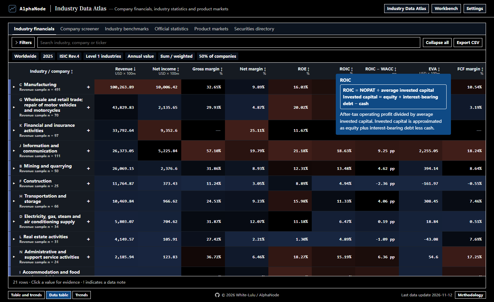

## 4. Data sources and calculations

| Data | Source and processing |
| --- | --- |
| Company financials and FX | [SEC EDGAR](https://www.sec.gov/search-filings/edgar-application-programming-interfaces), [ESEF](https://filings.xbrl.org/docs/about), East Money, [CNINFO](https://www.cninfo.com.cn/) and issuer disclosures. Convert amounts to current USD using [World Bank](https://data.worldbank.org/indicator/PA.NUS.FCRF), FRED and other FX series. Assign annual observations by fiscal year-end. |
| Industry financials and company screener | Both use the same financial statements. AlphaNode calculates margins, ROE, ROIC and free cash flow, then groups companies by [ISIC Rev.4](https://unstats.un.org/unsd/classifications/Econ/isic) or by their economic role. Identified listings of the same issuer are combined. |
| Industry benchmarks | [Aswath Damodaran's archived industry tables](https://pages.stern.nyu.edu/~adamodar/New_Home_Page/dataarchived.html), with date validation and unit conversion. Global industry WACC feeds estimates of company EVA. |
| Official statistics | [UN National Accounts](https://unstats.un.org/unsd/snaama/downloads), [UNIDO](https://stat.unido.org/unido-statistics-portal-api), [Eurostat](https://ec.europa.eu/eurostat/databrowser/view/sbs_ovw_act/default/table), China's [National Bureau of Statistics](https://www.stats.gov.cn/xxgk/sjfb/zxfb2020/202601/t20260127_1962382.html), [Federal Reserve H.15](https://www.federalreserve.gov/releases/h15/) and the [ECB](https://data.ecb.europa.eu/data/datasets/YC/YC.B.U2.EUR.4F.G_N_A.SV_C_YM.PY_10Y). AlphaNode calculates selected regional aggregates, shares and spreads. |
| Product markets | [IEA EV data](https://www.iea.org/data-and-statistics/data-tools/global-ev-data-explorer), [EIA-861](https://www.eia.gov/electricity/data/eia861/) and EIA gasoline data. AlphaNode estimates EV shares outside China, state-level electricity retail shares and HHI, and gasoline demand elasticity using monthly EIA data and CPI. |
| Securities directory and stock prices | The directory uses a pinned version of [FinanceDatabase](https://github.com/JerBouma/FinanceDatabase), with inferred primary listings and filing links. Adjusted weekly stock prices are requested on demand from Yahoo Finance. |

Worldwide company totals cover the project's sample. Official statistics retain the source's coverage. Year-over-year growth in industry amounts uses a matched sample, and changes in profitability ratios use percentage points. Missing reports, invalid denominators and inapplicable metrics appear as blank values. Use **Methodology** or click a table value for its source and calculation.

See the [data redistribution audit (Chinese)](docs/data-redistribution.md) for source terms and permissions that remain open.

## 5. Run and build

The frontend uses JavaScript, CSS and Canvas. Workbench state lives in the browser. Python builds JSON for the frontend and DuckDB and Parquet files for querying. Crible translates advanced screening expressions into parameterized SQL.

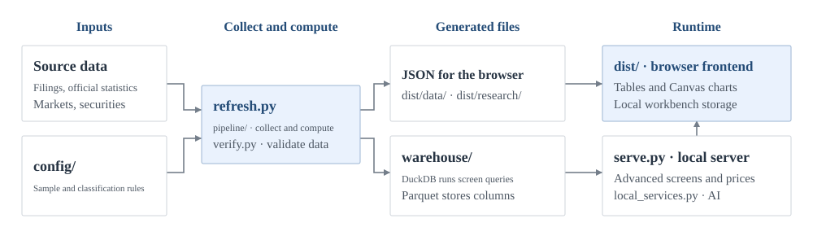

- [config/](config/) holds company samples and classification rules. [pipeline/](pipeline/) collects, computes and validates data.
- [dist/](dist/) contains the frontend. [serve.py](serve.py) and [server/local_services.py](server/local_services.py) run the local service.

### Run locally

Install Git and Python 3.13. If you already have a generated data bundle, unpack it into the project root. It should contain `dist/data/meta.json`, `dist/research/directory.json` and `warehouse/industrylab.duckdb`. To build those files, see the next section.

```powershell
python -m venv .venv
.venv/Scripts/python.exe scripts/setup-upstream.py --runtime
.venv/Scripts/python.exe -m pip install -r requirements/runtime.txt
.venv/Scripts/python.exe serve.py
```

Open `http://127.0.0.1:8766/`. Use `--port 8767` to change the port. On macOS and Linux, use `.venv/bin/python` in the commands above. On Windows, you can use [Start-AlphaNode.cmd](Start-AlphaNode.cmd) after setup. Existing annual data is available offline. Price data, updates and AI analysis require network access. For local default AI, set `ALPHANODE_ARK_API_KEY`, or enter a provider, key and model in **Settings → AI chart analysis**.

### Rebuild from sources

The first rebuild requires network access. Set `SEC_USER_AGENT` to an application identifier with a real contact email before downloading SEC data.

```powershell
python -m venv .venv
.venv/Scripts/python.exe scripts/setup-upstream.py
.venv/Scripts/python.exe -m pip install -r requirements/sources.txt
.venv/Scripts/python.exe pipeline/refresh.py
.venv/Scripts/python.exe pipeline/verify.py
```

- `pipeline/refresh.py --cached` rebuilds from existing source files. `--force` checks the sources again and keeps cached files when downloads fail.
- `pipeline/build.py --economic-functions` recalculates groups from the rules in `config/economic-function-*.txt`.
- `node scripts/build-upstream.mjs` rebuilds the Superset common-baseline module with Node.js 22.18 or newer. Normal use loads the bundled module.

### Upstream projects

| Project | How AlphaNode uses it |
| --- | --- |
| [Crible](https://github.com/maxgfr/crible) | Screening expression parsing, SQL compilation, Altman Z″ and Zmijewski diagnostics. |
| [FinanceToolkit](https://github.com/JerBouma/FinanceToolkit) | DuPont ROE decomposition and Altman ratio functions. |
| [FinanceDatabase](https://github.com/JerBouma/FinanceDatabase) | Securities directory and primary-listing inference. |
| [AKShare](https://github.com/akfamily/akshare) | Annual financial statements for Hong Kong listings. |
| [OpenBB](https://github.com/openbq-org/OpenBB) | Federal Reserve H.15 access and ECB series selection. |
| [Apache Superset](https://github.com/apache/superset) | Common-base-year transformation for trend charts. |
| [markdown-it](https://github.com/markdown-it/markdown-it) | Markdown rendering for AI analysis. |

## 6. Roadmap

- **Distributions.** Compare companies or industries at the same level, using equal-width or weight-scaled bars, quantiles and sample counts. [Distribution design (Chinese)](docs/distribution-view.md)
- **Per-share data and valuation.** Add EPS, free cash flow per share, P/E, P/B, EV/EBITDA and dividend yields. Compare valuation over time and explore the assumptions reflected in market prices.
- **Macroeconomic data.** Expand coverage of GDP, CPI, PPI, employment, industrial production, policy rates, yield curves, exchange rates, trade and public finances.
- **AI chart analysis.** Add optional web search with source links and deeper reasoning to the default configuration. Let custom providers accept extra JSON request parameters for temperature, reasoning and search tools.

## 7. Use, privacy and license

AlphaNode is for learning and research. Financial data and AI analysis may contain errors. Verify conclusions against original disclosures. This project does not provide investment advice.

Watchlists, trends, saved charts, AI responses, notes and preferences are stored in the current browser. Personal API keys are encrypted with Web Crypto (AES-GCM) and sent over HTTPS directly to the chosen provider, which must allow browser requests through CORS. AlphaNode does not collect personal keys. Clearing site data removes saved settings and keys. When you request analysis, the model service receives the selected chart data. The hosted default service forwards the request and uses a visitor cookie and network identifier to count free usage.

AlphaNode's own code is under the [MIT License](LICENSE). Third-party components, fonts, images and data retain their respective terms. The source repository excludes raw caches, generated data bundles, databases and full CSV exports.
