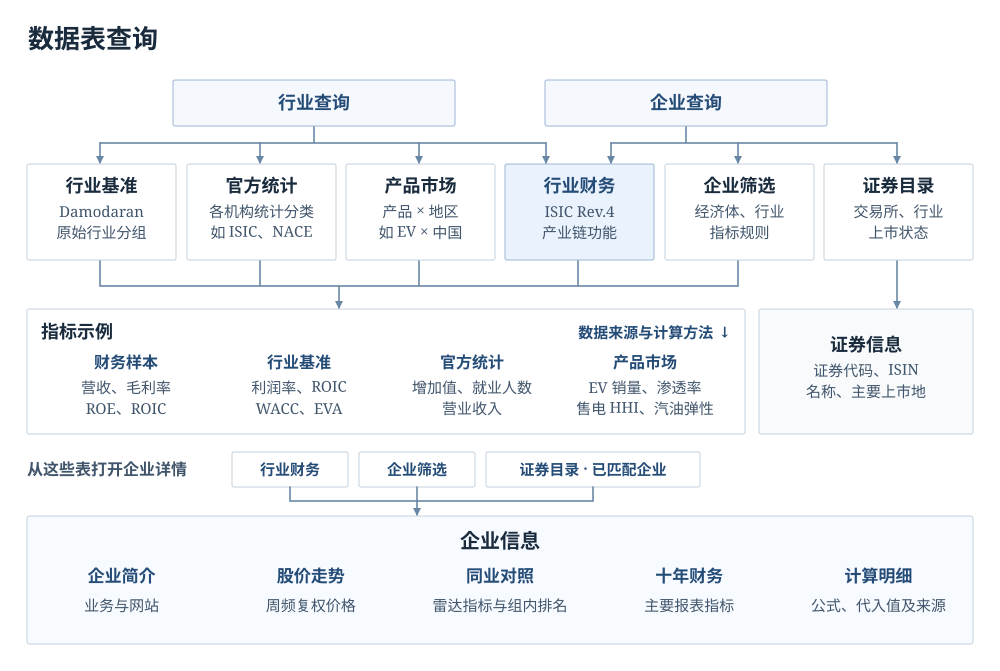
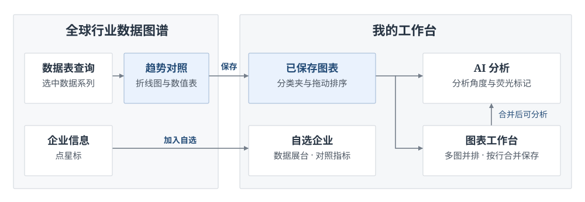
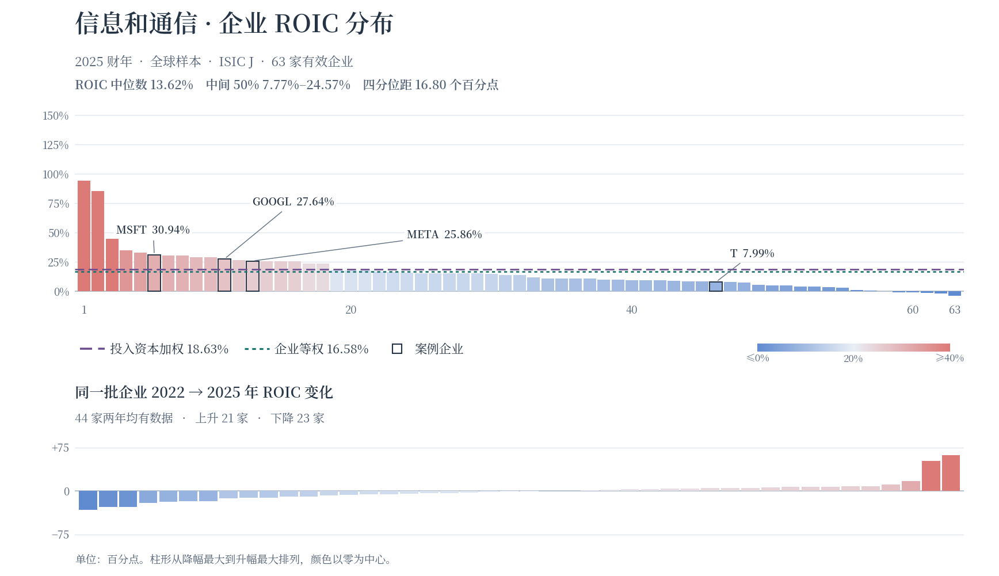
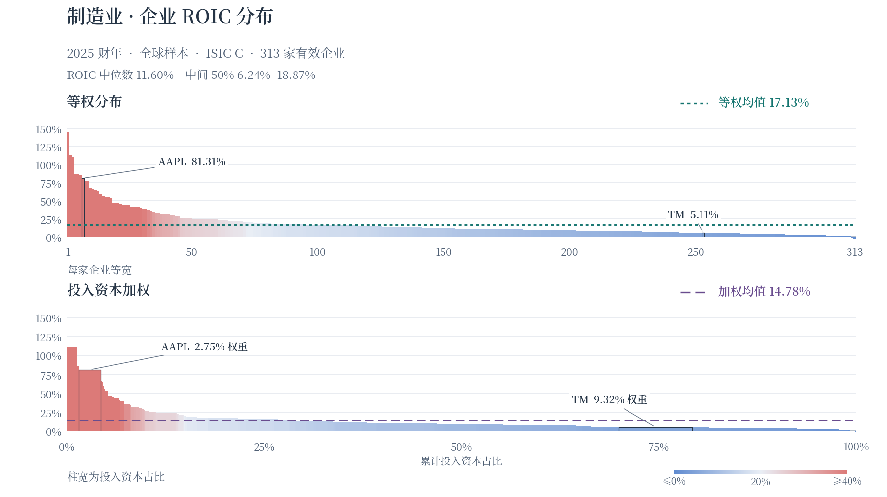
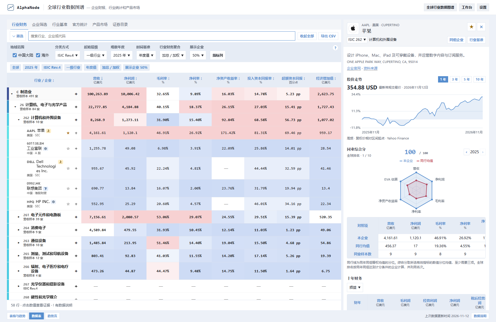
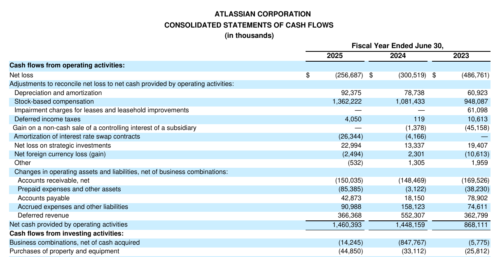
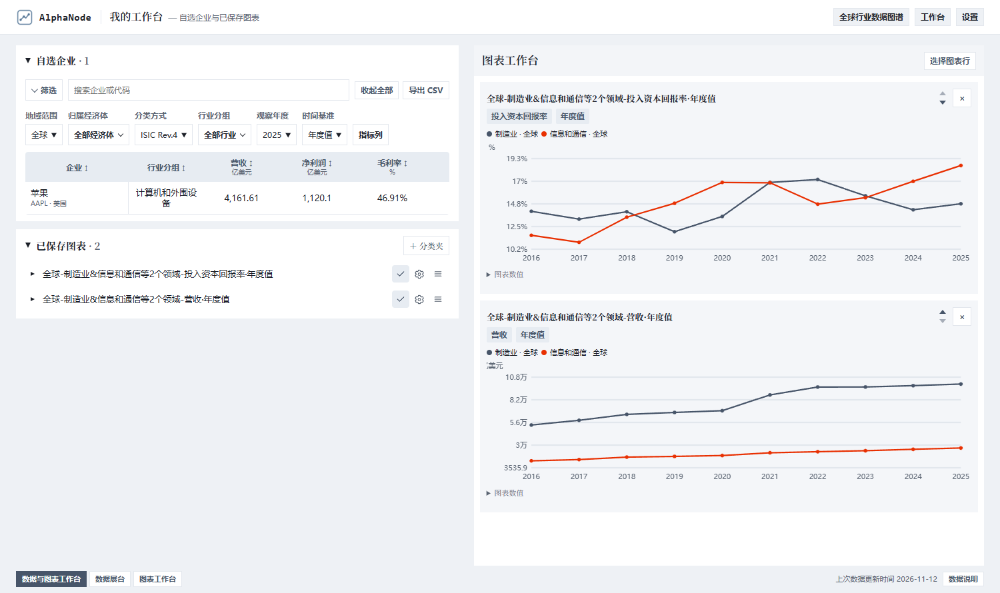
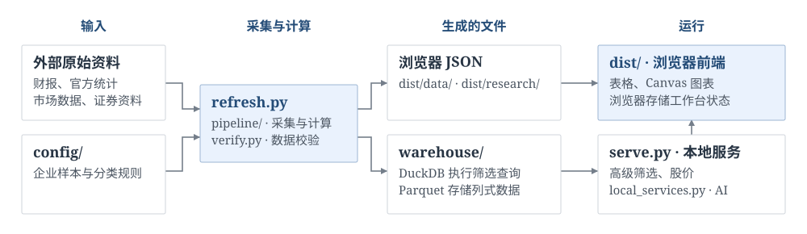

# AlphaNode · 全球行业数据图谱

## 1. 简介

AlphaNode（全球行业数据图谱）是一个用来学习、分析市场基本面的数据看板。我们从经营数据入手，观察行业发展趋势、企业靠什么赚钱、投入的资本能带来多少回报，以及这些差异能否持续。

首版财务数据覆盖 **2016–2025 年**，包含 **1,208 家企业、42 个经营归属经济体和 11,354 个企业年度**。证券目录包含 **121,601 条上市或历史记录**，其中 **1,165 家**已匹配本地财报。

## 2. 功能

### 数据表查询



- 各数据表的「筛选」可缩小比较范围，按需选择地域、经营归属经济体、行业层级、观察年度、时间基准和指标列。行业财务可切换加总／加权或等权均值。企业筛选可组合指标规则、写高级表达式和保存方案。

- 数值出处见[数据来源与计算方法](#4-数据来源与计算方法)。

### 趋势对照与工作台



- 趋势图支持切换指标、时间基准和共同基年，展开数值表，拖动分隔线调整布局。点击图例可回到数据表里的对应行。

### 设置


## 3. 使用示例

### 从行业回报率到一家公司的现金流

小八在做一份软件行业的研究笔记。众所周知，信息和通信的加权资本回报近几年上升了。小八想知道，是多数企业都在改善，还是少数权重较大的企业拉高了结果？小八先从行业排序查到企业权重，再挑两家软件企业，比较它们如何把毛利转成利润和现金。以下使用 AlphaNode 收录的 2016–2025 年财务数据。


#### ① 加权结果领先，换成等权均值还领先吗？

小八在「行业财务」选择 **ISIC Rev.4、全球、年度值、加总／加权**。用行内 **＋** 把制造业和信息和通信加入趋势图，指标选「投入资本回报率（ROIC）」。

结果显示，2022 年，信息和通信为 **14.75%**，制造业为 **17.22%**。到 2024 年，两者分别是 **17.04%** 和 **14.18%**，小八发现，这一段的排序反了过来。


进一步展开「信息和通信 → 出版 → 软件出版」，把这个细分行业也加进图里。另建一张图，将行业财务聚合切换为「等权均值」，再加一遍这三个序列。

| 全球样本 · 2025 年 ROIC | 加总／加权 | 等权均值 | 有效企业数 |
| --- | ---: | ---: | ---: |
| 信息和通信 | 18.63% | 16.58% | 63 |
| 制造业 | 14.78% | 17.13% | 313 |
| 软件出版 | 24.95% | 24.00% | 21 |

2025 年，信息和通信加权领先 **3.85 个百分点**，等权后却落后 **0.55 个百分点**。小八继续追查，是哪些企业改变了两种算法下的排序？也想看看，行业回报率上升时，有多少企业的回报真的在提高。

小八把每个行业的企业按 2025 年的 ROIC 从高到低排列。等权图的柱子一样宽，青线是企业等权均值。加权图的柱宽为投入资本占比，紫线是投入资本加权均值。两图的柱高都是企业各自的 ROIC，同用蓝低红高的色标。





两张行业图的中位数分别为 **13.62%** 和 **11.60%**。信息和通信的中位数更高，等权均值却更低。制造业右偏的分布里有一批很高的值，把平均值拉离了中位数。跨年对照也给了小八一个答案。同期有数据的 44 家信息和通信企业中，**21 家上升、23 家下降**。制造业的 267 家中，**112 家上升、155 家下降**。行业加权回报的走势掩盖了企业之间不同的方向。

点行业 ROIC 数值，展开「参与企业及披露」，可以查各家回报率。再从企业计算明细取出平均投入资本，统一换算为美元，用它重算权重。下表展示 2025 年几个影响较大的例子。

| 行业 | 企业 | ROIC | 占该行业有效投入资本 |
| --- | --- | ---: | ---: |
| 信息和通信 | 微软（MSFT） | 30.94% | 13.95% |
| 信息和通信 | Alphabet（GOOGL） | 27.64% | 15.84% |
| 信息和通信 | Meta（META） | 25.86% | 9.23% |
| 信息和通信 | AT&T（T） | 7.99% | 10.67% |
| 制造业 | 丰田（TM） | 5.11% | 9.32% |
| 制造业 | 苹果（AAPL） | 81.31% | 2.75% |

微软、Alphabet 和 Meta 的回报率都高于信息和通信均值，三家合计占 **39.02%** 的投入资本。AT&T 权重也高，回报率却低于行业均值，抵消了一部分拉升。用剩余企业重新计算，信息和通信的加权 ROIC 在 2024 年为 **10.46%**，2025 年为 **12.38%**，两年都低于同期制造业。制造业也有类似的拉扯，丰田的资本占比高于苹果，ROIC 却低得多。单独移出丰田后，2025 年制造业加权 ROIC 从 **14.78%** 升至 **15.78%**。

#### ② 同为八成以上毛利率，为什么一家还有经营亏损？

小八接下来想看，高毛利的软件企业能否留下同样多的利润。

在「企业筛选」把观察年度设为 **2025 年**，在「行业分组」勾选 **582 软件出版**。小八加了一条「毛利率至少 80%」的指标规则，留下 11 家企业，再按经营利润率降序排。在「指标列」同时显示毛利率、经营利润率、净利率、自由现金流率、毛利润、经营利润和研发强度。往下扫时，小八注意到排在前面的 Adobe 与出现经营亏损的 Atlassian，于是点星标将两家加入自选。

| 2025 财年 | 毛利率 | 经营利润率 | 净利率 | 自由现金流率 |
| --- | ---: | ---: | ---: | ---: |
| Adobe（ADBE） | 89.27% | 36.63% | 30.00% | 41.45% |
| Atlassian（TEAM） | 82.84% | −2.50% | −4.92% | 27.14% |

两家毛利率只差 **6.43 个百分点**，经营利润率却差了 **39.13 个百分点**。左表显示 Atlassian 毛利约 **43.20 亿美元**，经营亏损约 **1.30 亿美元**。按原报表的精确数值，用毛利减去负的经营利润，可得营业费用约 **44.51 亿美元**。点左表的 **51.18%** 打开「研发强度」计算明细，可追到其中约 **26.69 亿美元**的研发费用，约占营业费用的 **60%**。 [Atlassian 2025 财年 10-K](https://www.sec.gov/Archives/edgar/data/1650372/000165037225000036/team-20250630.htm)



小八去 Adobe 的年报查了同一项。Adobe 2025 财年研发支出约 **42.94 亿美元**，占营收 **18.07%**。Atlassian 的研发金额更低，但每 100 美元营收要承担约 **51 美元**的研发费用，Adobe 约为 **18 美元**。两家研发费率相差约 **33 个百分点**，是经营利润率差距中最大的一项。至于研发能否转成未来利润，还要看产品使用能否带来付费增长，以及扩大收入后毛利和现金流能留下多少。 [Adobe 2025 财年 10-K](https://www.sec.gov/Archives/edgar/data/796343/000079634326000003/adbe-20251128.htm) · [Atlassian 2025 财年 10-K](https://www.sec.gov/Archives/edgar/data/1650372/000165037225000036/team-20250630.htm)

#### ③ 有亏损，为什么还有正的自由现金流？

小八在同一个「计算明细」把指标从「研发强度」切换为「自由现金流率」，保留 **2025 年、年度值**。用原始美元数值复算：（**1,460,393,000** 经营现金流 − **44,850,000** 资本开支）÷ **5,215,304,000** 营收 ≈ **27.14%**。

点「计算明细」里的「SEC 申报」会打开 EDGAR 的申报详情页。在 **Document Format Files** 点第一行的 10-K，再到 **Item 8 → Consolidated Statements of Cash Flows**，核对 2025 年那一列。项目当前的链接指向含 2025 年比较数据的 2026 年年报，也可以直接查 2025 年原始申报。下面截取的是 2025 年 10-K 的现金流量表，单位为千美元。 [项目链接的申报详情](https://www.sec.gov/Archives/edgar/data/1650372/000165037226000036/0001650372-26-000036-index.htm) · [2025 年原始申报](https://www.sec.gov/Archives/edgar/data/1650372/000165037225000036/0001650372-25-000036-index.htm)



Atlassian 从净亏损调节到经营现金流时，加回了约 **13.62 亿美元**的股权激励，递延收入变动也贡献了约 **3.66 亿美元**。股权激励计入费用，当期无需等额付现，所以会拉开利润与经营现金流。


不过要判断现金流改善能否持续，还得看收款时点、资本开支以及股权激励对股东的稀释。 [Atlassian 2025 财年 10-K · 现金流量表](https://www.sec.gov/Archives/edgar/data/1650372/000165037225000036/team-20250630.htm)

#### ④ 未来要关注什么

把两家企业加进两张趋势图，一张看经营利润率，一张看自由现金流率。保存后到「工作台」，用图表标题旁的 **＋** 把两张图放进图表工作台，排成一行，再用「选择图表行 → 合并保存」把它们收进同一份研究记录。

小八对着两张图发现，Atlassian 的经营利润率从 2023 年的 **−9.77%** 回升到 2025 年的 **−2.50%**。从 2024 到 2025 年，自由现金流只从约 **14.150 亿**增至 **14.155 亿美元**，同期营收增长约 **19.7%**。营收长得更快，自由现金流率便从 **32.47%** 回落到 **27.14%**。这两年，Adobe 的经营利润率从 **31.35%** 回升至 **36.63%**，自由现金流率也从 **36.61%** 升至 **41.45%**。

Adobe 的两条线还受同一件事影响。2024 财年的 **10 亿美元 Figma 收购终止费**同时压低了经营利润和经营现金流。仅在 2024 年的经营利润中加回这项费用，利润率约为 **36.00%**，与 2025 年的 **36.63%** 接近。两张图看起来都在改善，回到原报表才知道改善的幅度有多少来自一次性费用。 [Adobe 2025 财年 10-K](https://www.sec.gov/Archives/edgar/data/796343/000079634326000003/adbe-20251128.htm)

可以对合并图表发起 AI 分析。小八这样提问。

> 对比 Adobe 和 Atlassian 在 2023–2025 年经营利润率与自由现金流率的变化。分别指出两家公司在哪一年出现方向背离，再提出两条需要回财报核对的问题。

截图展示了方舟模型的完整回复。小八用荧光笔标记了两家企业自由现金流率的变化，又选中 Adobe 的一句分析，打开「复制、标记、取消标记」菜单。回复里提到的折旧摊销、营运资金和收款节奏可以作为回查财报的线索。



小八为 Atlassian 留下三组复查项。先观察云订阅收入和云订阅年化收入超过 1 万美元的客户数，找研发成果进入商业使用的线索。再对照研发费率、毛利率和经营利润率，判断收入增长后利润率是否改善。最后用自由现金流、股权激励和递延收入变动核对现金表现。研发到收入可能间隔数年，合并财报也很少按项目披露成本和收益，适合先跟踪这组指标的连续变化。 [Atlassian 2025 财年 10-K · 关键经营指标](https://www.sec.gov/Archives/edgar/data/1650372/000165037225000036/team-20250630.htm)

## 4. 数据来源与计算方法

| 数据 | 来源与处理 |
| --- | --- |
| 企业财务和汇率 | 来自 [SEC EDGAR](https://www.sec.gov/search-filings/edgar-application-programming-interfaces)、[ESEF](https://filings.xbrl.org/docs/about)、东方财富、[巨潮资讯](https://www.cninfo.com.cn/) 和企业直接披露。金额按 [世界银行](https://data.worldbank.org/indicator/PA.NUS.FCRF)、FRED 等汇率折为现价美元，按财年截止日归年。 |
| 行业样本和企业筛选 | 两页共用同一批企业财报。AlphaNode 计算利润率、ROE、ROIC 和自由现金流等指标，再按 [ISIC Rev.4](https://unstats.un.org/unsd/classifications/Econ/isic) 或自定义产业链功能聚合。产业链功能按主营用途划为消费、生产工具、源材料和服务／金融／医疗，并合并已识别的同主体上市记录。 |
| 行业基准 | 读取 [NYU Damodaran 原表](https://pages.stern.nyu.edu/~adamodar/New_Home_Page/dataarchived.html)，做日期校验和单位转换。企业财务也引用其中的全球行业 WACC，再结合企业投入资本估算 EVA。 |
| 官方统计 | 来自 [联合国国民账户](https://unstats.un.org/unsd/snaama/downloads)、[UNIDO](https://stat.unido.org/unido-statistics-portal-api)、[Eurostat](https://ec.europa.eu/eurostat/databrowser/view/sbs_ovw_act/default/table)、[国家统计局](https://www.stats.gov.cn/xxgk/sjfb/zxfb2020/202601/t20260127_1962382.html)、[美联储 H.15](https://www.federalreserve.gov/releases/h15/) 和 [ECB](https://data.ecb.europa.eu/data/datasets/YC/YC.B.U2.EUR.4F.G_N_A.SV_C_YM.PY_10Y)。保留各机构的统计范围，并计算部分区域汇总、占比和利差。 |
| 产品市场 | 读取 [IEA 电动车数据](https://www.iea.org/data-and-statistics/data-tools/global-ev-data-explorer)、[EIA-861](https://www.eia.gov/electricity/data/eia861/) 和 EIA 汽油数据。项目据此计算海外 EV 渗透率、州级售电 HHI 和市占率，并用 EIA 月度数据和 CPI 回归估算汽油需求弹性。 |
| 证券目录和股价 | 目录来自锁定版本的 [FinanceDatabase](https://github.com/JerBouma/FinanceDatabase)，推定主上市及财报链接由项目生成。股价按需读取 Yahoo Finance 的周频复权数据。 |

行业财务的「全球」指纳入样本中的全球企业。官方统计保留各机构的调查范围，产品市场保留各自的分母。行业财务金额同比在共同样本上计算，利润率同比用百分点表示。缺报、无效基数和不适用指标保留空值。页面右下角的「数据说明」与表格数值明细提供更具体的出处和公式。

## 5. 技术与构建

浏览器端用原生 JavaScript、CSS 和 Canvas 实现表格与图表，工作台状态存于本地浏览器。Python 将公开披露和统计原表整理成供浏览器读取的 JSON 文件，并生成 DuckDB 数据库和 Parquet 文件。高级表达式通过 Crible 编译为参数化 SQL，在本机 DuckDB 上执行。Python 服务监听回环地址，适用于单用户运行。



- [config/](config/) 包含企业样本与分类规则，[pipeline/](pipeline/) 负责采集、计算和验证。
- [dist/](dist/) 存放前端，[serve.py](serve.py) 和 [local_services.py](local_services.py) 负责本地服务。原始缓存与生成的数据文件在运行和构建时按需准备。

### 本地启动

需要 Git 和 Python 3.13。将数据包解压到项目根目录，确认其中有 `dist/data/meta.json`、`dist/research/directory.json` 和 `warehouse/industrylab.duckdb`。也可按下一节自行生成。

```powershell
python -m venv .venv
.venv/Scripts/python.exe setup-upstream.py --runtime
.venv/Scripts/python.exe -m pip install -r requirements-runtime.txt
.venv/Scripts/python.exe serve.py
```

Windows 完成安装后也可双击「启动工作台.cmd」。macOS 和 Linux 将上述命令中的 `.venv/Scripts/python.exe` 换成 `.venv/bin/python`。本地默认地址为 `http://127.0.0.1:8766/`，可用 `--port 8767` 换端口。已有年度数据可离线浏览，股价、AI 分析和数据更新需要联网。本地默认方舟接口使用环境变量 `ALPHANODE_ARK_API_KEY`，也可在「设置 → AI 图表分析」填写自定义接口、密钥与模型。

### 从数据源重建

首次重建需要联网。下载 SEC 数据前，将 `SEC_USER_AGENT` 设为包含真实联络邮箱的应用标识。各数据源的可用年份和后续修订会影响重建结果。

```powershell
python -m venv .venv
.venv/Scripts/python.exe setup-upstream.py
.venv/Scripts/python.exe -m pip install -r requirements-sources.txt
.venv/Scripts/python.exe refresh.py
.venv/Scripts/python.exe pipeline/verify.py
```

- `refresh.py --cached` 用已有原始资料重建。 `--force` 重新检查来源，下载失败时保留可用缓存。
- `pipeline/build.py --economic-functions` 根据 `config/economic-function-*.txt` 和现有财务数据重算自定义分类。
- `node build-upstream.mjs` 重新编译 Superset 的共同基年变换模块，需要 Node.js 22.18 或更新版本。日常运行使用仓库内的已编译模块。

### 接入与参考项目

| 项目 | 实际用途 |
| --- | --- |
| [Crible](https://github.com/maxgfr/crible) | 高级表达式解析、SQL 编译、Altman Z″ 和 Zmijewski 诊断。 |
| [FinanceToolkit](https://github.com/JerBouma/FinanceToolkit) | 杜邦 ROE 拆解及 Altman 比率函数。 |
| [FinanceDatabase](https://github.com/JerBouma/FinanceDatabase) | 证券目录和推定主上市规则。 |
| [AKShare](https://github.com/akfamily/akshare) | 港股年度三表采集。 |
| [OpenBB](https://github.com/openbq-org/OpenBB) | 美联储 H.15 数据接入及 ECB 序列选择。 |
| [Apache Superset](https://github.com/apache/superset) | 趋势对照的共同基年变换。 |
| [markdown-it](https://github.com/markdown-it/markdown-it) | AI 分析的 Markdown 渲染。 |

上游代码提交及接入文件列在 [upstream.lock.json](upstream.lock.json)。TIKR 和 Koyfin 是界面交互参考。

## 6. 未来计划

- **分布与权重。** 增加可交互的同层行业和企业分布视图，支持等宽与按权重绘制、分位数、样本数和重点企业定位。[分布视图设计与软件出版示例](docs/distribution-view.md)
- **每股数据与估值。** 增加基本和稀释每股收益（EPS）、每股自由现金流、市盈率（P/E）、市净率（P/B）、EV/EBITDA 和股息率。把股价和估值放在同一时间轴上，区分历史已披露数据与市场预期，再探索用不同增长、利润率假设做情景对照，观察当前价格可能反映了什么预期。
- **经济体与全球宏观。** 在已有国民账户和部分利率序列的基础上，扩展实际与名义 GDP、CPI、PPI、就业与工业生产、央行政策利率和收益率曲线、汇率与贸易、政府财政收支及公共债务。展示原始发布频率、单位与更新时间，支持把宏观序列与行业数据放在一起观察。

## 7. 许可证

AlphaNode 自有代码采用 [MIT 许可证](LICENSE)。第三方组件和字体保留各自的许可证及版权声明。

财报、统计数据、证券资料、企业标识和第三方插图适用各来源的条款。源码仓库排除原始缓存、生成的数据包、数据库和完整 CSV。

### 使用说明

本项目用于学习与研究。财务数据与 AI 分析可能有误，应以原始披露为准，不构成投资建议。

### 隐私与 API Key

- 自选企业、趋势图、已保存图表、AI 回复、标记和偏好保存在当前浏览器。
- 自定义 AI 配置及个人 API Key 用浏览器的 Web Crypto（AES-GCM）加密保存。AlphaNode 不收集个人 API Key。浏览器使用 HTTPS 直接向你选择的模型服务发送带密钥的请求，服务需允许浏览器跨域访问（CORS）。清除站点数据会移除已保存的配置和密钥。
- 发起分析会将所选图表的数据发送给模型服务。使用网站默认 AI 时，由 AlphaNode 服务端转发图表数据，并用访客 Cookie 和网络标识计量免费额度。使用自定义 AI 时，图表数据及分析角度直接发给你所选的服务。
