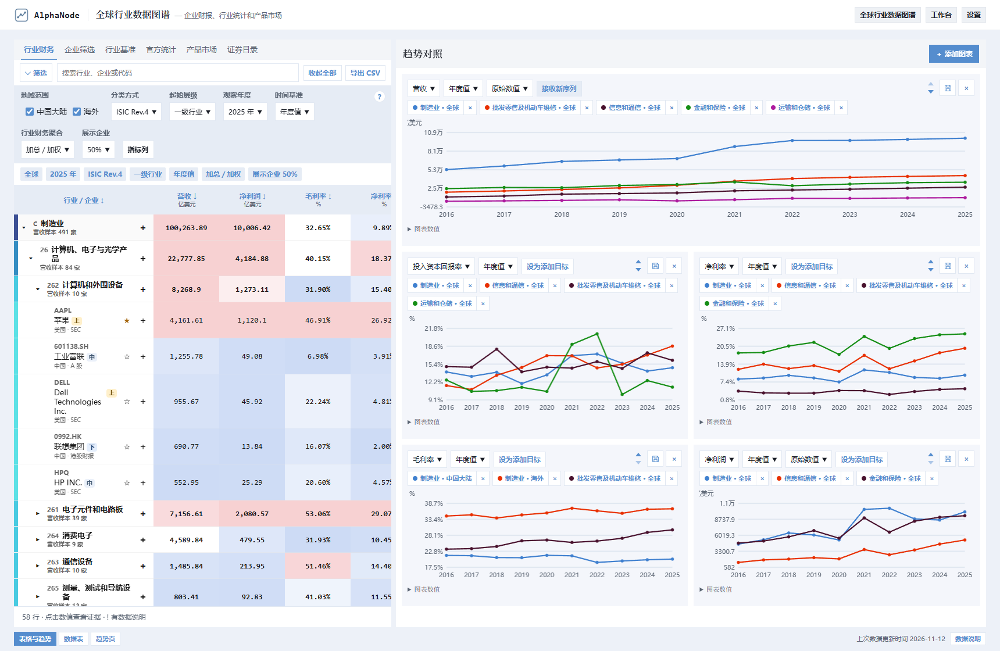

# AlphaNode · 全球行业数据图谱

## 1. 简介

AlphaNode 是一款本地行业研究工作台。可以从行业财务筛到具体企业，把利润、资本回报、官方统计和产品市场走势放在一起对照，并从数值追溯到报表、计算式和原始来源。

首版财务数据覆盖 **2016–2025 年**，包含 **1,208 家企业、42 个经营归属经济体和 11,354 个企业年度**。证券目录包含 **121,601 条上市或历史记录**，其中 **1,165 家**已匹配本地财报。

## 2. 功能

| 页面 | 可以做什么 |
| --- | --- |
| 行业财务 | 在 ISIC Rev.4 和产业链功能间切换，逐级查看行业和企业，比较样本合计、加权比率与等权均值。 |
| 企业筛选 | 按归属经济体、行业和指标组合筛选企业，保存筛选方案，或用高级表达式查询年度数据。 |
| 行业基准 | 按地区和参考年查看 Damodaran 发布的利润率、资本回报率、WACC 和 EVA。 |
| 官方统计 | 查询国民账户、工业调查、欧盟企业统计、中国规上工业数据以及美欧利率。 |
| 产品市场 | 查看电动车销量和渗透率、美国州级售电份额与 HHI、汽油需求弹性估算。 |
| 证券目录 | 按代码、名称、ISIN、交易所、行业和上市状态查找证券，打开已匹配的财报。 |

- **趋势对照**可自定义指标、时间基准和共同基年。图表支持调整大小、换行和展开数值表，工作状态会在刷新后恢复。数据表支持导出 CSV。
- **企业详情**汇集周频股价、同业雷达图和全球排名、十年财务及计算明细。可以切换同业分类和观察年度。
- **工作台**集中管理自选企业和图表收藏。可创建分类夹、拖动排序、按图表行合并保存，并对收藏图表生成和标记 AI 分析。

## 3. 使用方法

### 安装和启动

需要 Git 和 Python 3.13。将数据包解压到项目根目录，确认能找到 `dist/data/meta.json`、`dist/research/directory.json` 和 `warehouse/industrylab.duckdb`。也可以按[从数据源重建](#从数据源重建)生成所需文件。

```powershell
python -m venv .venv
.venv/Scripts/python.exe setup-upstream.py --runtime
.venv/Scripts/python.exe -m pip install -r requirements-runtime.txt
.venv/Scripts/python.exe serve.py
```

Windows 完成安装后也可双击「启动工作台.cmd」。macOS 和 Linux 将上述命令中的 `.venv/Scripts/python.exe` 换成 `.venv/bin/python`。服务默认打开 `http://127.0.0.1:8766/`，可用 `--port 8767` 换端口。已有年度数据可离线浏览，股价、AI 分析和数据更新需要联网。

### 查行业和对照趋势

1. 在「行业财务」点「筛选」，选择分类方式、地域范围、观察年度和起始层级。用搜索框找企业或行业，点「指标列」调整显示字段，点表头排序。
2. 点某行的 **＋** 将该序列加入右侧接收新序列的图表。用图表顶部菜单选择指标和时间基准。支持共同基年的年度序列可以显示相对变化。
3. 用左下角的「表格与趋势」「数据表」「趋势页」切换视图。拖动分隔线调整大小。点图例可定位左表中的对应行，图例旁的 **×** 移除序列。



在「设置 → 显示配置」开启「按层级着色」，即可显示左侧色条。

### 筛企业和查计算明细

1. 在「企业筛选」点「筛选」，按经济体或行业分组缩小范围。点「＋ 指标规则」设置指标、时间基准和阈值。多条规则同时生效，可保存为方案。
2. 「高级表达式」支持 AND、OR、NOT 和 IN。例如 `roic >= 0.12 AND (fcfMargin >= 0.08 OR cashConversion >= 1.2)`。这里的比例用小数，金额用美元原数值。
3. 点企业名称打开右侧详情。点星标加入自选，切换同业年度或分类查看排名与雷达图。往下可查看十年财务和计算明细，核对原始报表、代入值及来源。


### 收藏、合并和分析图表

1. 在趋势图右上角点保存图标，确认或修改图名。进入「工作台」的「数据展台」，可查看自选企业和已保存图表，也可建分类夹并拖动排序。
2. 点收藏图表标题右侧的 **＋** 加入「图表工作台」。左下角可切换单独视图或并排视图。点「选择图表行」后勾选并「合并保存」，新图表沿用原有分行。
3. 展开收藏图表后点「AI 分析」。默认方舟接口读取环境变量 `ALPHANODE_ARK_API_KEY`，也可在「设置 → AI 图表分析」填写自定义接口、密钥与模型。生成后的 Markdown 可选中文字添加或移除荧光标记。


截图中的分析是用图中数据编写的演示文本。

趋势、收藏、自选、分析结果和显示配置保存在当前浏览器的本站数据中。清除网站数据或改用其他浏览器、域名、端口会影响这些记录的访问。

## 4. 数据来源与计算方法

| 数据 | 来源与处理 |
| --- | --- |
| 企业财务和汇率 | 来自 [SEC EDGAR](https://www.sec.gov/search-filings/edgar-application-programming-interfaces)、[ESEF](https://filings.xbrl.org/docs/about)、东方财富、[巨潮资讯](https://www.cninfo.com.cn/) 和企业直接披露。金额按 [世界银行](https://data.worldbank.org/indicator/PA.NUS.FCRF)、FRED 等汇率折为现价美元，按财年截止日归年。 |
| 行业样本和企业筛选 | 两页共用同一批企业财报。AlphaNode 计算利润率、ROE、ROIC 和自由现金流等指标，再按 [ISIC Rev.4](https://unstats.un.org/unsd/classifications/Econ/isic) 或自定义产业链功能聚合。产业链功能按主营用途划为消费、生产工具、源材料和服务／金融／医疗，并合并已识别的同主体上市记录。 |
| 行业基准 | 读取 [NYU Damodaran 原表](https://pages.stern.nyu.edu/~adamodar/New_Home_Page/dataarchived.html)，做日期校验和单位转换。企业财务也引用其中的全球行业 WACC，再结合企业投入资本估算 EVA。 |
| 官方统计 | 来自 [联合国国民账户](https://unstats.un.org/unsd/snaama/downloads)、[UNIDO](https://stat.unido.org/unido-statistics-portal-api)、[Eurostat](https://ec.europa.eu/eurostat/databrowser/view/sbs_ovw_act/default/table)、[国家统计局](https://www.stats.gov.cn/xxgk/sjfb/zxfb2020/202601/t20260127_1962382.html)、[美联储 H.15](https://www.federalreserve.gov/releases/h15/) 和 [ECB](https://data.ecb.europa.eu/data/datasets/YC/YC.B.U2.EUR.4F.G_N_A.SV_C_YM.PY_10Y)。保留各机构的统计范围，并计算部分区域汇总、占比和利差。 |
| 产品市场 | 读取 [IEA 电动车数据](https://www.iea.org/data-and-statistics/data-tools/global-ev-data-explorer)、[EIA-861](https://www.eia.gov/electricity/data/eia861/) 和 EIA 汽油数据。项目据此计算海外 EV 渗透率、州级售电 HHI 和市占率，并用 EIA 月度数据和 CPI 回归估算汽油需求弹性。 |
| 证券目录和股价 | 目录来自锁定版本的 [FinanceDatabase](https://github.com/JerBouma/FinanceDatabase)，推定主上市及财报链接由项目生成。股价按需读取 Yahoo Finance 的周频复权数据。 |

行业财务的「全球」指纳入样本中的全球企业。官方统计保留各机构的调查范围，产品市场保留各自的分母。行业财务金额同比在共同样本上计算，利润率同比用百分点表示。缺报、无效基数和不适用指标保留空值。页面右下角的「数据说明」与表格数值明细提供更具体的出处和公式。

## 5. 技术与构建

浏览器端用原生 JavaScript、CSS 和 Canvas 实现表格与图表，工作台状态存于本地浏览器。Python 将公开披露和统计原表整理成供浏览器读取的 JSON 文件，并生成 DuckDB 数据库和 Parquet 文件。高级表达式通过 Crible 编译为参数化 SQL，在本机 DuckDB 上执行。Python 服务监听回环地址，适用于单用户运行。

### 从数据源重建

首次重建需要联网。下载 SEC 数据前，将 `SEC_USER_AGENT` 设为包含真实联络邮箱的应用标识。各数据源的可用年份和后续修订会影响重建结果。

```powershell
python -m venv .venv
.venv/Scripts/python.exe setup-upstream.py
.venv/Scripts/python.exe -m pip install -r requirements-sources.txt
.venv/Scripts/python.exe refresh.py
.venv/Scripts/python.exe pipeline/verify.py
```

- `refresh.py --cached` 用已有原始资料重建。 `--force` 重新检查来源，下载失败时保留可用缓存。
- `pipeline/build.py --economic-functions` 根据 `config/economic-function-*.txt` 和现有财务数据重算自定义分类。
- `node build-upstream.mjs` 重新编译 Superset 的共同基年变换模块，需要 Node.js 22.18 或更新版本。日常运行使用仓库内的已编译模块。

### 接入与参考项目

| 项目 | 实际用途 |
| --- | --- |
| [Crible](https://github.com/maxgfr/crible) | 高级表达式解析、SQL 编译、Altman Z″ 和 Zmijewski 诊断。 |
| [FinanceToolkit](https://github.com/JerBouma/FinanceToolkit) | 杜邦 ROE 拆解及 Altman 比率函数。 |
| [FinanceDatabase](https://github.com/JerBouma/FinanceDatabase) | 证券目录和推定主上市规则。 |
| [AKShare](https://github.com/akfamily/akshare) | 港股年度三表采集。 |
| [OpenBB](https://github.com/openbq-org/OpenBB) | 美联储 H.15 数据接入及 ECB 序列选择。 |
| [Apache Superset](https://github.com/apache/superset) | 趋势对照的共同基年变换。 |
| [markdown-it](https://github.com/markdown-it/markdown-it) | AI 分析的 Markdown 渲染。 |

上游代码提交及接入文件列在 [upstream.lock.json](upstream.lock.json)。TIKR 和 Koyfin 是界面交互参考。

## 6. 许可证

AlphaNode 自有代码的开源许可证待项目维护者确定。第三方代码沿用各自的许可证，随仓库分发的组件说明位于 [dist/vendor](dist/vendor/)。

财报、统计数据、证券资料及企业标识适用各来源的条款。源码仓库排除原始缓存、生成的数据包、数据库、完整 CSV 和本机 AI 配置。
