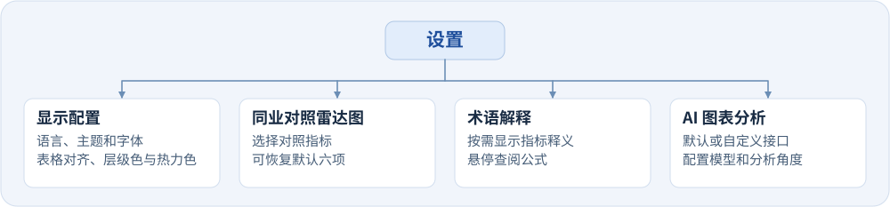

# AlphaNode · 全球行业数据图谱

## 1. 简介

AlphaNode（全球行业数据图谱）是一个用来学习市场基本面的数据看板。名字里的 **Alpha** 取寻找超额收益线索之意。我们从经营数据入手，观察企业靠什么赚钱、投入的资本能带来多少回报，以及这些差异能否持续。

把财报、官方统计和产品市场数据放在同一个看板上，就能先看市场的长期方向和各行业的经营水平，再下钻到企业，找出行业均值掩盖的差异。数据表可以直接对照，各年的变化也可以画在同一张图上，遇到意外的数字还能回到计算式和原始资料核对。

首版财务数据覆盖 **2016–2025 年**，包含 **1,208 家企业、42 个经营归属经济体和 11,354 个企业年度**。证券目录包含 **121,601 条上市或历史记录**，其中 **1,165 家**已匹配本地财报。

## 2. 功能

### 数据表查询


在各数据表的「筛选」里缩小比较范围，按需选择地域、经营归属经济体、行业层级、观察年度、时间基准和指标列。点表头可以升序或降序排列，也可导出 CSV。行业财务提供加总／加权和等权均值，企业筛选还可以组合指标规则、写高级表达式和保存方案。数值出处见[数据来源与计算方法](#4-数据来源与计算方法)。

### 趋势对照与工作台


趋势图支持切换指标、时间基准和共同基年，展开数值表，拖动分隔线调整布局。点击图例可回到数据表里的对应行。工作台支持图表分类和拖动排序，合并后的图表保留所选行的排布，也可交给 AI 分析。

### 设置



## 3. 使用示例

### 从行业回报率上升，追到软件企业的利润与现金

**① 先找变化。** 在「行业财务」选择 **ISIC Rev.4 → 全球 → 年度值 → 加总／加权**。用行内 **＋** 将「信息和通信」和「制造业」加入同一张趋势图，指标选「投入资本回报率（ROIC）」。图中信息和通信从 2016 年的 **11.61%** 升至 2025 年的 **18.63%**，2024 年已高于制造业的 **14.18%**（同期信息和通信为 **17.04%**）。这里的「全球」指本项目收录的全球企业样本。


**② 再看行业内部。** 展开「信息和通信 → 出版 → 软件出版」，将「软件出版」也加入图中。它在 2025 年的加权 ROIC 为 **24.95%**。接着在「企业筛选」把行业分组限定为「软件出版」，观察年度选 2025，按净利率排序，再对照毛利率、经营利润率和自由现金流率。同组的 Adobe 与 Atlassian 就呈现了两种截然不同的结果。

| 2025 年企业财务 | 毛利率 | 经营利润率 | 净利率 | 自由现金流率 |
| --- | ---: | ---: | ---: | ---: |
| Adobe（ADBE） | 89.27% | 36.63% | 30.00% | 41.45% |
| Atlassian（TEAM） | 82.84% | −2.50% | −4.92% | 27.14% |

**③ 把差异追到报表。** 点企业名打开右侧详情，点星标加入自选。Atlassian 毛利率仍高，经营利润率却为负。先检查毛利到营业利润之间的营业费用，再通过计算明细核对自由现金流率所用的经营现金流和资本开支。两家公司的股价可各选相同区间，作为同期市场表现的参照。


**④ 并排验证，留下下一年的观察条件。** 将两家企业都加入两张趋势图，一张对比「经营利润率」，另一张对比「自由现金流率」。保存两图，在「工作台」点 **＋** 加入图表工作台，把两图放同一行。点「选择图表行」，勾选该行并「合并保存」。打开合并图表后可以请 AI 按年份核对两图的差异。

> 标出 Atlassian 经营利润率与自由现金流率走势分化最明显的年份，用图中数值和 Adobe 对照。最后列出下一份年报应核实的两项数据。

下一个观察点是 Atlassian 能否在维持自由现金流率的同时改善经营利润率。新财报出来后，可以核实股权激励和营运资金变动对两者差异的影响。分析中的关键段落可选中并加荧光标记，方便回看。


趋势、自选企业、收藏和分析记录随当前浏览器及访问地址保存。清除站点数据会移除这些记录，换浏览器或域名时需在原环境查看。

## 4. 数据来源与计算方法

| 数据 | 来源与处理 |
| --- | --- |
| 企业财务和汇率 | 来自 [SEC EDGAR](https://www.sec.gov/search-filings/edgar-application-programming-interfaces)、[ESEF](https://filings.xbrl.org/docs/about)、东方财富、[巨潮资讯](https://www.cninfo.com.cn/) 和企业直接披露。金额按 [世界银行](https://data.worldbank.org/indicator/PA.NUS.FCRF)、FRED 等汇率折为现价美元，按财年截止日归年。 |
| 行业样本和企业筛选 | 两页共用同一批企业财报。AlphaNode 计算利润率、ROE、ROIC 和自由现金流等指标，再按 [ISIC Rev.4](https://unstats.un.org/unsd/classifications/Econ/isic) 或自定义产业链功能聚合。产业链功能按主营用途划为消费、生产工具、源材料和服务／金融／医疗，并合并已识别的同主体上市记录。 |
| 行业基准 | 读取 [NYU Damodaran 原表](https://pages.stern.nyu.edu/~adamodar/New_Home_Page/dataarchived.html)，做日期校验和单位转换。企业财务也引用其中的全球行业 WACC，再结合企业投入资本估算 EVA。 |
| 官方统计 | 来自 [联合国国民账户](https://unstats.un.org/unsd/snaama/downloads)、[UNIDO](https://stat.unido.org/unido-statistics-portal-api)、[Eurostat](https://ec.europa.eu/eurostat/databrowser/view/sbs_ovw_act/default/table)、[国家统计局](https://www.stats.gov.cn/xxgk/sjfb/zxfb2020/202601/t20260127_1962382.html)、[美联储 H.15](https://www.federalreserve.gov/releases/h15/) 和 [ECB](https://data.ecb.europa.eu/data/datasets/YC/YC.B.U2.EUR.4F.G_N_A.SV_C_YM.PY_10Y)。保留各机构的统计范围，并计算部分区域汇总、占比和利差。 |
| 产品市场 | 读取 [IEA 电动车数据](https://www.iea.org/data-and-statistics/data-tools/global-ev-data-explorer)、[EIA-861](https://www.eia.gov/electricity/data/eia861/) 和 EIA 汽油数据。项目据此计算海外 EV 渗透率、州级售电 HHI 和市占率，并用 EIA 月度数据和 CPI 回归估算汽油需求弹性。 |
| 证券目录和股价 | 目录来自锁定版本的 [FinanceDatabase](https://github.com/JerBouma/FinanceDatabase)，推定主上市及财报链接由项目生成。股价按需读取 Yahoo Finance 的周频复权数据。 |

行业财务的「全球」指纳入样本中的全球企业。官方统计保留各机构的调查范围，产品市场保留各自的分母。行业财务金额同比在共同样本上计算，利润率同比用百分点表示。缺报、无效基数和不适用指标保留空值。页面右下角的「数据说明」与表格数值明细提供更具体的出处和公式。

## 5. 技术与构建

浏览器端用原生 JavaScript、CSS 和 Canvas 实现表格与图表，工作台状态存于本地浏览器。Python 将公开披露和统计原表整理成供浏览器读取的 JSON 文件，并生成 DuckDB 数据库和 Parquet 文件。高级表达式通过 Crible 编译为参数化 SQL，在本机 DuckDB 上执行。Python 服务监听回环地址，适用于单用户运行。


- [config/](config/) 包含企业样本与分类规则，[pipeline/](pipeline/) 负责采集、计算和验证。
- [dist/](dist/) 存放前端，[serve.py](serve.py) 和 [local_services.py](local_services.py) 负责本地服务。原始缓存与生成的数据文件在运行和构建时按需准备。

### 本地启动

需要 Git 和 Python 3.13。将数据包解压到项目根目录，确认其中有 `dist/data/meta.json`、`dist/research/directory.json` 和 `warehouse/industrylab.duckdb`。也可按下一节自行生成。

```powershell
python -m venv .venv
.venv/Scripts/python.exe setup-upstream.py --runtime
.venv/Scripts/python.exe -m pip install -r requirements-runtime.txt
.venv/Scripts/python.exe serve.py
```

Windows 完成安装后也可双击「启动工作台.cmd」。macOS 和 Linux 将上述命令中的 `.venv/Scripts/python.exe` 换成 `.venv/bin/python`。本地默认地址为 `http://127.0.0.1:8766/`，可用 `--port 8767` 换端口。已有年度数据可离线浏览，股价、AI 分析和数据更新需要联网。本地默认方舟接口使用环境变量 `ALPHANODE_ARK_API_KEY`，也可在「设置 → AI 图表分析」填写自定义接口、密钥与模型。

### 从数据源重建

首次重建需要联网。下载 SEC 数据前，将 `SEC_USER_AGENT` 设为包含真实联络邮箱的应用标识。各数据源的可用年份和后续修订会影响重建结果。

```powershell
python -m venv .venv
.venv/Scripts/python.exe setup-upstream.py
.venv/Scripts/python.exe -m pip install -r requirements-sources.txt
.venv/Scripts/python.exe refresh.py
.venv/Scripts/python.exe pipeline/verify.py
```

- `refresh.py --cached` 用已有原始资料重建。 `--force` 重新检查来源，下载失败时保留可用缓存。
- `pipeline/build.py --economic-functions` 根据 `config/economic-function-*.txt` 和现有财务数据重算自定义分类。
- `node build-upstream.mjs` 重新编译 Superset 的共同基年变换模块，需要 Node.js 22.18 或更新版本。日常运行使用仓库内的已编译模块。

### 接入与参考项目

| 项目 | 实际用途 |
| --- | --- |
| [Crible](https://github.com/maxgfr/crible) | 高级表达式解析、SQL 编译、Altman Z″ 和 Zmijewski 诊断。 |
| [FinanceToolkit](https://github.com/JerBouma/FinanceToolkit) | 杜邦 ROE 拆解及 Altman 比率函数。 |
| [FinanceDatabase](https://github.com/JerBouma/FinanceDatabase) | 证券目录和推定主上市规则。 |
| [AKShare](https://github.com/akfamily/akshare) | 港股年度三表采集。 |
| [OpenBB](https://github.com/openbq-org/OpenBB) | 美联储 H.15 数据接入及 ECB 序列选择。 |
| [Apache Superset](https://github.com/apache/superset) | 趋势对照的共同基年变换。 |
| [markdown-it](https://github.com/markdown-it/markdown-it) | AI 分析的 Markdown 渲染。 |

上游代码提交及接入文件列在 [upstream.lock.json](upstream.lock.json)。TIKR 和 Koyfin 是界面交互参考。

## 6. 许可证

AlphaNode 自有代码的开源许可证待项目维护者确定。第三方代码沿用各自的许可证，随仓库分发的组件说明位于 [dist/vendor](dist/vendor/)。

财报、统计数据、证券资料及企业标识适用各来源的条款。源码仓库排除原始缓存、生成的数据包、数据库、完整 CSV 和本机 AI 配置。
