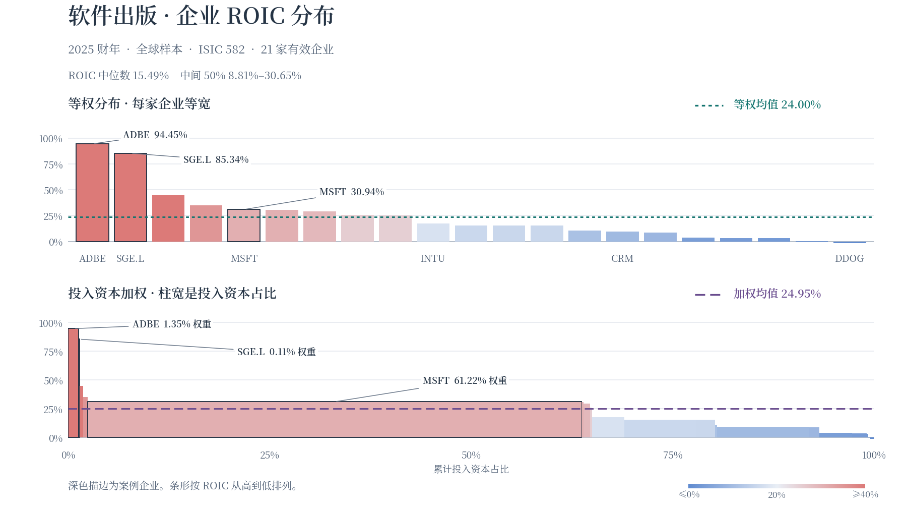

# 行业与企业分布 · 下一版本设计

在「行业财务」增加「查看分布」。沿用所选指标、地域、观察年度和分类方式。打开一个行业时，可选同层行业、该行业的下一级行业，或该行业下的企业。每次只展示一种层级，同一主体计一次。默认使用所选范围内有有效值的全部样本，标明样本数和缺失数。

- **两种排序柱图**。两图按指标值从左到右降序排列，使用相同纵轴和热力色，负值从零线向下。等权图每个观测等宽，横轴显示名称或排名。加权图的柱宽按权重占比，横轴显示累计占比，柱形的有符号面积对应对加权均值的贡献。悬停、触屏点按或键盘聚焦可看名称、数值和权重，点击可定位数据表。
- **各自的均值线**。等权线是各观测的算术平均。财务比率沿用项目现有权重，例如 ROIC 用平均投入资本、净利率用营收。比较子行业时，加权线汇总底层分子与分母。权重缺失的观测保留在等权图，统计摘要分别列出两图样本数。没有既定权重的指标只提供等权图。
- **分布与离散程度**。首版显示中位数、P25、P75 和四分位距，帮助区分典型范围与长尾。样本量大时可切到累计分布，横轴是指标值，纵轴是小于或等于该值的样本比例。使用经验分布，不假定数据符合正态分布。
- **权重与影响**。两条均值线使用同一批有效样本时，可按「对加权与等权差距的贡献」列出影响最大的几项。每项用「权重占比减等权占比」乘以「指标值减等权均值」，结果保留正负方向。两批样本不同时显示范围差异，可切到共同样本后做归因。

## 软件出版示例

微软的 ROIC 为 **30.94%**，占有效投入资本的 **61.22%**。加权图中的微软因此覆盖横轴六成以上。Adobe 和 Sage 的 ROIC 都超过 **85%**，合计资本占比只有 **1.46%**，在加权图里只占很窄的一段。等权均值 **24.00%** 和加权均值 **24.95%** 很接近，图形却清楚显示了两种算法各自受哪些企业影响。
